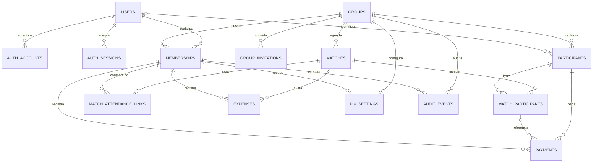

# Arquitetura do banco de dados

## Escopo e regra adotada

PostgreSQL + Prisma em um monólito modular, conforme [regra original](../architecture-rule.md). O [schema.sql](schema.sql) preserva o modelo físico de referência. O scaffold inclui schema Prisma e migration inicial em `backend/prisma`, que passam a definir o esquema aplicado. Não há tabelas de empresas ou CNPJ empresarial, pois esses exemplos do arquivo enviado não pertencem ao domínio da pelada.

Um banco e um schema `public` são suficientes. Separar responsabilidade por módulo no código, sem criar um banco por módulo ou microserviços. A fonte das regras é o Domain; constraints do banco reforçam a integridade dos dados.

## Propriedade dos dados

| Módulo                      | Tabelas                                                 | Responsabilidade                                            |
| --------------------------- | ------------------------------------------------------- | ----------------------------------------------------------- |
| auth                        | users, auth_accounts, auth_sessions, auth_verifications | E-mail/senha e sessões geridas pelo Better Auth             |
| groups                      | groups, memberships, pix_settings, group_invitations    | Peladas, administradores, convites, tema e destinatário Pix |
| participants                | participants                                            | Cadastro e modalidade atual                                 |
| matches                     | matches, match_participants, match_attendance_links     | Agenda, presença, modalidade histórica e link público       |
| finance                     | payments, expenses                                      | Recebimentos, despesas e anulações                          |
| infraestrutura de auditoria | audit_events                                            | Rastreabilidade das mutações                                |
| team-draw                   | nenhuma no MVP                                          | Sorteio em memória sem modificar o financeiro               |

## Relações



Uma pelada é criada junto com seu primeiro administrador em transação. O diagrama representa essa regra de aplicação; o SQL sozinho não exige ao menos um administrador.

## Tipos e convenções

- UUIDs gerados pela aplicação/Infrastructure; o SQL não depende de extensão para gerar IDs.
- `timestamptz` para instantes, enviados em UTC; `timezone` da pelada controla a apresentação.
- `integer` para valores positivos em centavos por lançamento, máximo de 2.147.483.647 centavos. Agregações retornam valores maiores: converter com verificação de limites, sem perda de precisão no JSON.
- BRL é a única moeda do MVP, reforçada por check.
- `competence` é `varchar(7)` com formato e mês válidos `AAAA-MM`, exclusivo de recebimentos mensais. Não é uma data de vencimento.
- Estados fechados usam enums PostgreSQL. Não confundir enums Prisma com entidades do Domain; mapear na Infrastructure.
- Nomes não são únicos, pois há homônimos. E-mail não é chave da conta: identidade é o par provedor/subject.
- `created_at` e `updated_at` têm valor inicial no banco. A Infrastructure deve atualizar `updated_at` em cada alteração, via Prisma `@updatedAt` ou escrita explícita; `DEFAULT` não atualiza sozinho.

## Integridade garantida pelo SQL

- FKs compostas incluem `group_id`, impedindo vínculo de partida, presença, destinatário ou lançamento a outra pelada.
- Recebimento por partida referencia também `participant_id`, impedindo atribuição ao participante errado.
- Uma conta possui no máximo um participante ativo por pelada (índice único parcial).
- Uma pessoa aparece uma vez por partida. Vários administradores são permitidos, com papel em memberships, nunca em users.
- Recebimento aponta para exatamente uma participação ou uma competência, tem valor positivo e chave de idempotência única por pelada.
- Despesas também têm chave de idempotência própria. Uma mesma chave com conteúdo diferente deve produzir conflito, nunca substituir o lançamento.
- Anulação exige motivo, autor e data; lançamento confirmado não pode ter campos de anulação preenchidos.
- FKs usam `RESTRICT` e não apagam histórico em cascata. Desativar registros com histórico.
- Uma configuração Pix por pelada; destinatário precisa ser um membro da mesma pelada. Papel ADMIN e estado ativo são verificados pelo caso de uso.

FK não valida acesso do usuário autenticado. O servidor deve limitar consultas por pelada autorizada e filtrar detalhes financeiros por participante vinculado ao usuário, exceto para administradores.

## Regras transacionais dos casos de uso

Application conhece uma porta de unidade de trabalho para operações que exigem atomicidade. A Infrastructure implementa essa porta com transação Prisma e repositórios vinculados à mesma transação; não passar PrismaClient para Application.

1. **Criar pelada:** gravar grupo, primeiro membro ADMIN ativo e auditoria na mesma transação.
2. **Mudar administradores/Pix:** bloquear a linha da pelada no banco antes de ler membros; conferir que sobra um ADMIN ativo; trocar ou remover o destinatário Pix se necessário; gravar alterações e auditoria. Todas as operações que alteram papéis, atividade e destinatário usam o mesmo bloqueio. SQL de bloqueio pertence à Infrastructure.
3. **Registrar recebimento/despesa:** conferir administrador ativo, referências e valor; inserir lançamento e auditoria atomicamente. Restrição única impede repetição concorrente. Ao receber a mesma chave, comparar conteúdo e retornar o lançamento existente ou conflito.
4. **Corrigir financeiro:** atualizar somente os campos de anulação com condição `status = CONFIRMED`; criar substituto com nova chave de idempotência e auditar na mesma transação. Preservar valor, referência e autor originais. Não permitir atualização genérica nem delete de lançamento.
5. **Atualizar modalidade:** modificar participante; a modalidade copiada em `match_participants` permanece intacta.
6. **Confirmar presença pelo link:** procurar hash, bloquear a pelada e revalidar hash/expiração/revogação/estado. Resolver nome normalizado apenas em participantes ativos dessa pelada, rejeitando homônimos ambíguos; criar diarista sem conta quando necessário. Reutilizar ou inserir presença única, marcar `public_confirmed_at` e auditar com autor nulo. Não alterar valores esperados ou lançamentos. Geração/revogação usa o mesmo bloqueio e exige ADMIN ativo.

Não usar checks com consulta a outras tabelas para validar último administrador. Essa regra exige leitura consistente e controle de concorrência no caso de uso/repositório. A imutabilidade de lançamentos e auditoria também depende dos contratos de escrita; o blueprint não inclui triggers nem políticas de acesso por linha.

## Caixa sem dupla contagem

Receitas e despesas devem ser agregadas separadamente e só então combinadas. Fazer join das duas listas antes de somar multiplica registros e gera totais errados.

```sql
WITH revenue AS (
  SELECT mp.group_id, mp.match_id, SUM(p.amount_cents) AS cents
  FROM payments p
  JOIN match_participants mp
    ON (mp.group_id, mp.id, mp.participant_id) =
       (p.group_id, p.match_participant_id, p.participant_id)
  WHERE p.group_id = $1 AND p.status = 'CONFIRMED'
  GROUP BY mp.group_id, mp.match_id
), cost AS (
  SELECT group_id, match_id, SUM(amount_cents) AS cents
  FROM expenses
  WHERE group_id = $1 AND status = 'CONFIRMED'
  GROUP BY group_id, match_id
)
SELECT m.id,
       COALESCE(r.cents, 0) AS revenue_cents,
       COALESCE(c.cents, 0) AS expense_cents,
       COALESCE(r.cents, 0) - COALESCE(c.cents, 0) AS balance_cents
FROM matches m
LEFT JOIN revenue r ON (r.group_id, r.match_id) = (m.group_id, m.id)
LEFT JOIN cost c ON (c.group_id, c.match_id) = (m.group_id, m.id)
WHERE m.group_id = $1 AND m.id = $2;
```

Os parâmetros são IDs autorizados e devem ser vinculados pela biblioteca, sem interpolação de texto. Essa consulta é referência para implementação na Infrastructure. Mensalidades sem participação não entram no caixa da partida. Situação de quitação é derivada do esperado e do total, sem coluna redundante `paid`.

## Índices justificados

PKs e constraints únicas já criam índices. Índices adicionais atendem às consultas previstas:

| Índice                                                             | Uso                                        |
| ------------------------------------------------------------------ | ------------------------------------------ |
| memberships(user_id, active)                                       | Peladas acessíveis ao usuário              |
| participants(group_id, user_id) WHERE active e user_id preenchido  | Unicidade do vínculo ativo                 |
| participants(group_id, nome normalizado) WHERE active              | Reutilizar nome no check-in, sem unicidade |
| matches(group_id, starts_at)                                       | Agenda da pelada                           |
| match_participants(group_id, participant_id)                       | Histórico de partidas de um participante   |
| payments(group_id, match_participant_id, status)                   | Total por participação e caixa             |
| payments(group_id, participant_id, received_at)                    | Histórico financeiro individual            |
| payments(group_id, competence, status) WHERE competence preenchida | Financeiro mensal                          |
| expenses(group_id, match_id, status)                               | Despesas do caixa                          |
| audit_events(group_id, created_at)                                 | Histórico administrativo                   |

Não indexar JSON de auditoria ou todas as colunas preventivamente. Reavaliar com planos e consultas reais quando a aplicação existir.

## Prisma e migrations

No ambiente Docker, o serviço `migrate` aplica as migrations versionadas automaticamente após PostgreSQL ficar saudável; o backend só inicia após sucesso. As dez tabelas e todas as colunas são criadas pela migration inicial existente, sem `db push` ou um script paralelo de criação. O volume `postgres_data` mantém o histórico e os dados entre reinicializações.

- Modelos e migrations ficam em `backend/prisma`; não em Domain. O SQL desta pasta é referência arquitetural, não uma segunda sequência de migrations.
- O modelo Prisma e a migration inicial foram criados. Checks e índices parciais são mantidos no SQL da migration; migrations versionadas são a fonte do esquema aplicado. Não aplicar o blueprint separado sobre um banco já migrado.
- Não usar `db push` como substituto do histórico de migrations. Não gerar migrations destrutivas para contornar divergências.
- Manter constraints e índices personalizados nas próximas migrations. Mapear tabelas/colunas e erros técnicos dentro da Infrastructure.
- A função de consulta de caixa retorna uma projeção financeira por contrato; não expor tipos Prisma ou um repositório genérico às camadas internas.
- Configurar `DATABASE_URL` somente em ambiente e `.env.example` sem credenciais reais. Usar conexão exclusiva do servidor.
- Autenticação definida: migration `20261011000200_auth_invitations_corrections` acrescenta e-mail único normalizado, campos de identidade, tabelas Better Auth e convites por hash. Convites referenciam membros da mesma pelada, possuem e-mail, papel, expiração, aceitação e revogação. Não persistir o token de convite em texto puro.
- Payments/expenses recebem `replaces_id` único, com FK composta para a mesma pelada e check contra auto-referência. A correção exige original confirmado e anula/cria/audita na mesma transação. Esta migration é aditiva e mantém todos os checks e índices parciais originais.
- `20261012000100_public_attendance` adiciona `match_attendance_links` com hash único, uma linha por partida, expiração, revogação e FKs compostas para partida/criador. Acrescenta `public_confirmed_at` às presenças, permite auditoria anônima com ator nulo e indexa nomes ativos normalizados sem proibir homônimos. Migration aditiva, sem apagar dados.
- `schema.sql` permanece o blueprint da migration inicial. Para todas as tabelas atuais, use `schema.prisma` e as três migrations versionadas; não aplicar o blueprint sobre o banco migrado.

PostgreSQL documenta constraints compostas e índices únicos parciais em [Constraints](https://www.postgresql.org/docs/current/ddl-constraints.html). A necessidade de preservar recursos não representados no schema Prisma está descrita em [Database features](https://docs.prisma.io/docs/orm/v7/reference/database-features).

## Validação antes de aplicar migrations

Em PostgreSQL descartável, validar: schema completo; valores negativos/zero; mês inválido; vínculo entre peladas; participante errado no recebimento; duplicação de presença, conta ativa e idempotência; anulação incompleta; receitas com múltiplas despesas sem multiplicação; preservação de histórico. Nos testes de casos de uso, validar permissões, último administrador concorrente, correção imutável e isolamento das consultas.

O chore adicionou testes automatizados da migration em PostgreSQL embarcado descartável (PGlite) e um workflow que aplica migrations no PostgreSQL 18 e verifica a conexão real do backend. A execução local em Docker depende da disponibilidade do Engine; não confundir os testes embarcados com validação do container PostgreSQL 18.

Em 11/10/2026, a migration inicial foi aplicada ao PostgreSQL 18.6 local em Docker. A inspeção confirmou dez tabelas de domínio com 91 colunas, além da tabela de controle `_prisma_migrations`. O readiness do backend e o acesso pelo proxy do frontend retornaram `status: ok`. Lint, tipos, 13 testes e builds também passaram em um container Linux temporário.

Em 12/10/2026, as duas migrations foram aplicadas no banco principal preservando os dados. A inspeção confirmou 14 tabelas da aplicação, além de `_prisma_migrations`. Os testes HTTP completos usam PostgreSQL 18.6 em bancos temporários separados.

Ainda em 12/10/2026, a terceira migration de check-in compartilhado foi aplicada de forma aditiva. O banco principal contém 15 tabelas da aplicação; as três migrations constam como concluídas. A integração HTTP valida reutilização de participantes, reenvio concorrente, isolamento, FKs compostas, revogação/renovação/expiração e preservação do caixa. Revisão visual usa dados fictícios em banco separado.
